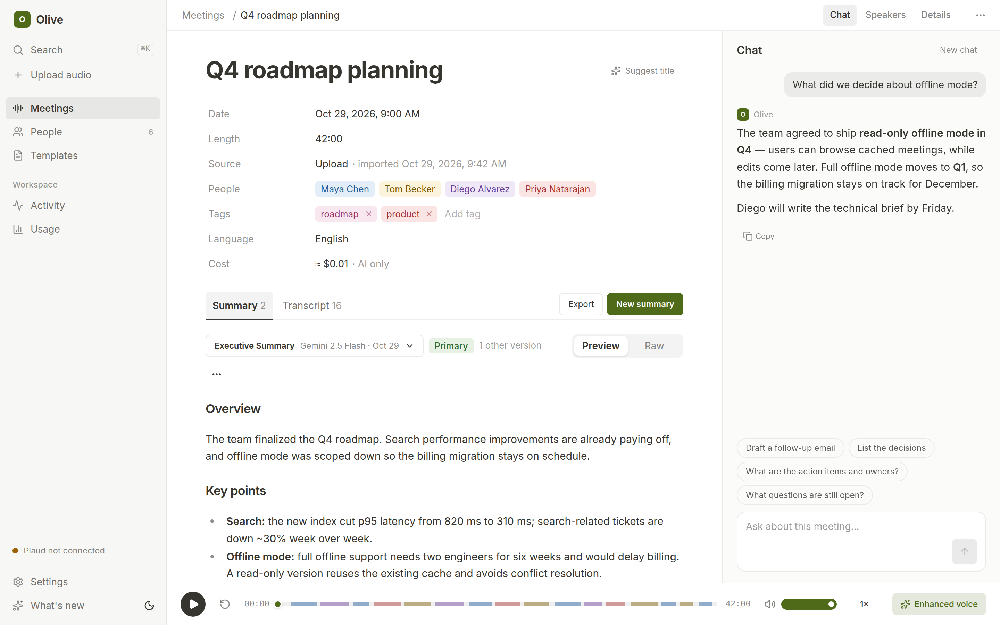
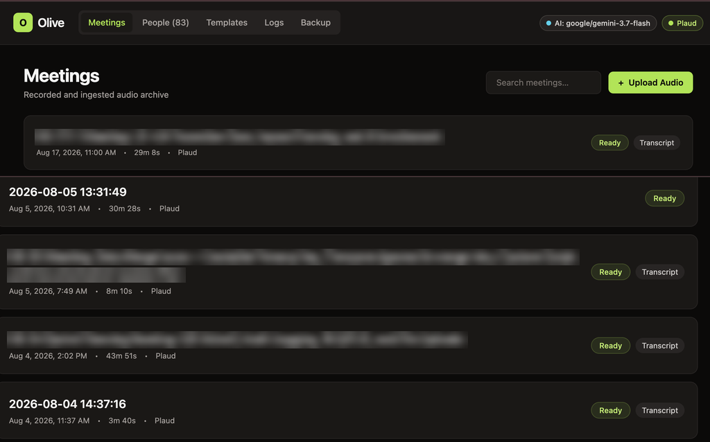
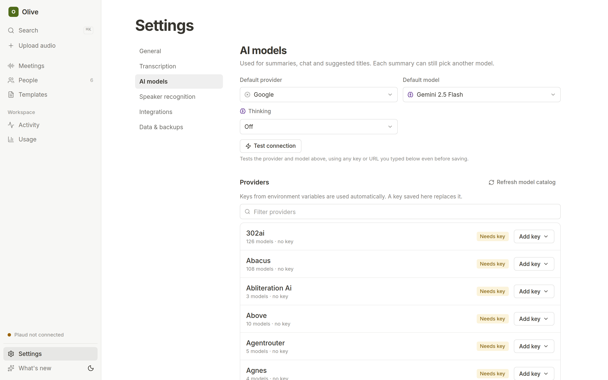
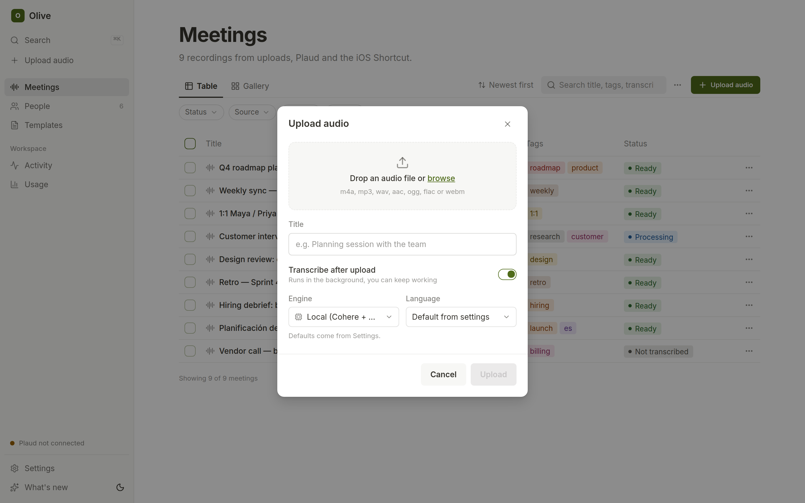
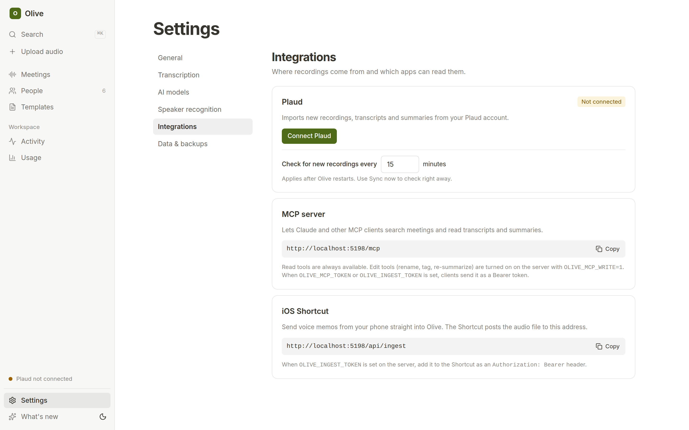
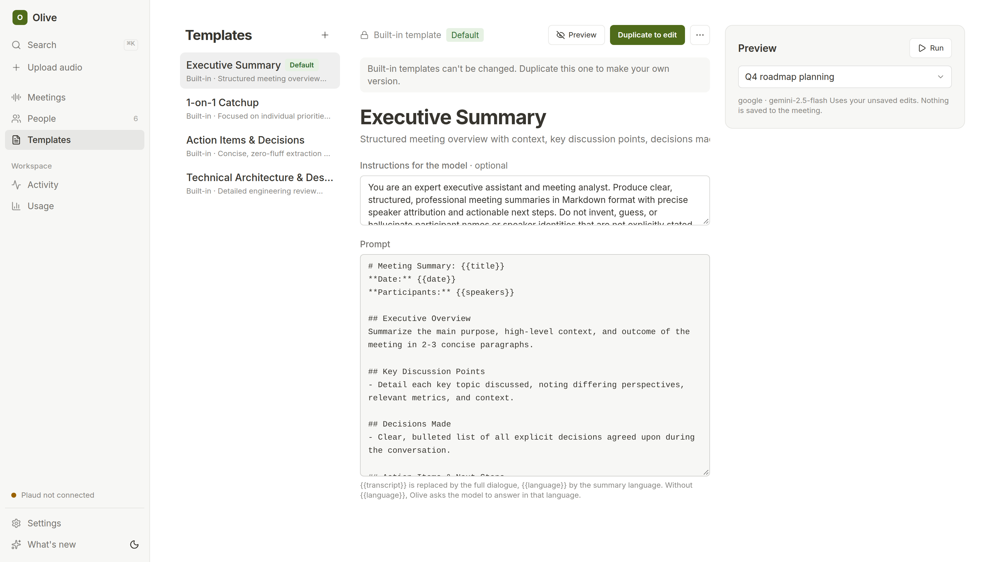
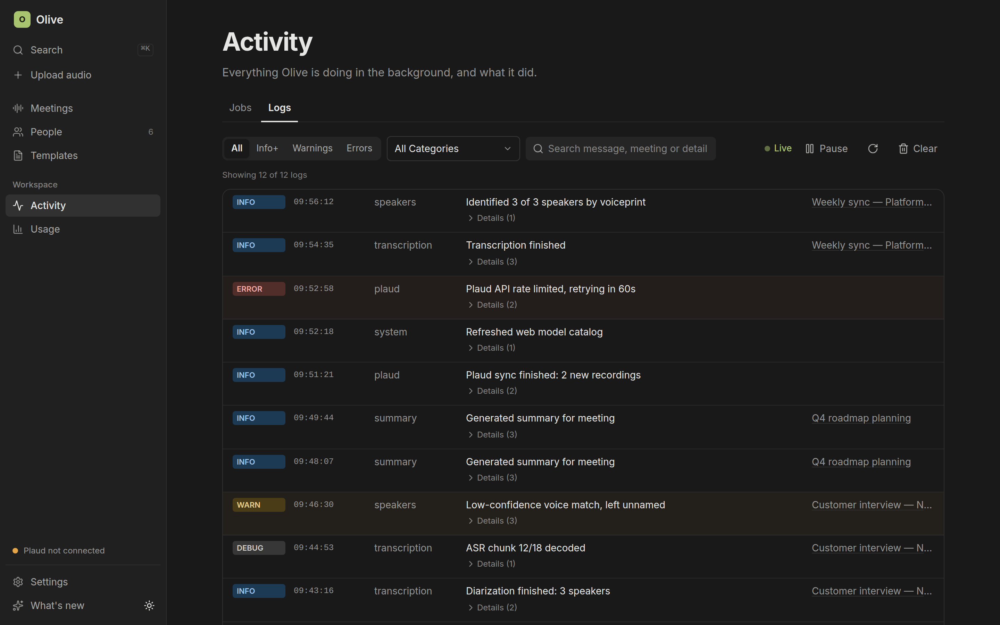
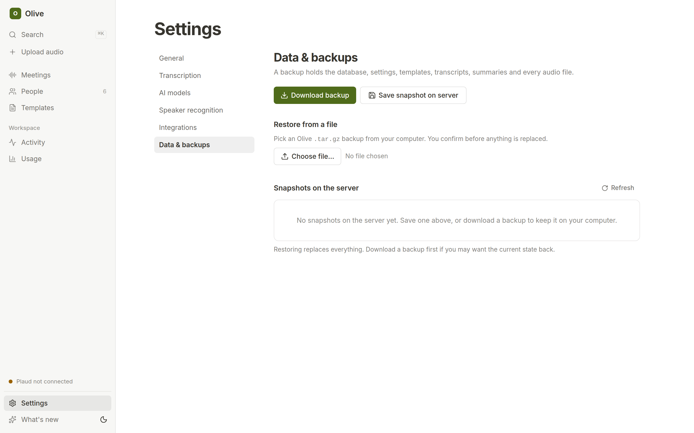

<div align="center">

# Olive

**Self-hosted meeting transcription, speaker diarization, and audio archive**

Ingests audio from Plaud hardware recorders, iOS Voice Memos, and browser uploads. Runs local or cloud transcription, matches speakers across meetings with neural voiceprints, and generates Markdown summaries from prompt templates.

[](https://python.org)
[](https://fastapi.tiangolo.com/)
[](https://www.typescriptlang.org/)
[](https://react.dev/)
[](https://tailwindcss.com/)
[](https://sqlite.org/)
[](https://github.com/pyannote/pyannote-audio)
[](https://github.com/wenet-e2e/wespeaker)
[](https://huggingface.co/CohereLabs/cohere-transcribe-03-2026)
[](https://docker.com)

<br/>



</div>

---

## Features

| Feature | Description |
| :--- | :--- |
| **Multi-source audio ingestion** | Upload `.m4a`, `.mp3`, `.wav`, `.aac`, `.ogg`, `.flac`, `.webm` with SHA-256 deduplication and optional auto-transcription. |
| **Plaud Note integration** | OAuth 2.0 PKCE sync with Plaud Cloud. Polls in the background for recordings, transcripts, and AI notes. |
| **Apple Voice Memos shortcut** | One-tap iOS Share-Sheet shortcut to upload recordings directly from iPhone or iPad. |
| **Dual transcription pipeline** | Local neural STT (Cohere Transcribe 03-2026 INT8 ONNX + CTC forced alignment) or cloud Speechmatics. |
| **Speaker diarization & voiceprints** | Local `pyannote.audio` (`speaker-diarization-community-1`) + WeSpeaker ResNet293-LM 256-dim embeddings for cross-meeting speaker recognition. |
| **Multi-provider LLM summaries** | Powered by `any-llm` and the `models.dev` catalog. Works with Gemini, Claude, OpenAI, Groq, OpenRouter, Ollama, or custom OpenAI-compatible proxies. |
| **Summary templates** | Prompt templates (`Executive Summary`, `1-on-1 Catchup`, `Technical Architecture & Design Review`, `Action Items & Decisions`) with `{{title}}`, `{{date}}`, `{{speakers}}`, and `{{transcript}}` variables. |
| **System & job logs** | Streaming log viewer with category filters, severity levels (`DEBUG` to `ERROR`), and JSON detail inspection. |
| **Backup & restore** | Single-click `.tar.gz` export and restore containing the SQLite snapshot, settings, speaker clips, transcripts, summaries, and raw audio files. |

---

## Screenshots

### Meeting archive & detail view

<div align="center">
  
  <p><em>Meetings dashboard with full-text search across titles, tags, transcripts, and summaries.</em></p>
</div>

<br/>

<div align="center">
  
  <p><em>Meeting detail view with seekable audio player, speaker assignment pills, and Markdown summaries.</em></p>
</div>

---

### LLM provider & local ASR settings

<div align="center">
  
  <p><em>Model catalog, reasoning/thinking level config, Hugging Face token, and diarization/voiceprint thresholds.</em></p>
</div>

---

### Ingestion & Plaud sync

<div align="center">
  <table>
    <tr>
      <td width="50%" align="center">
        
        <br/>
        <em>Direct audio upload with auto-transcribe toggle and engine selector.</em>
      </td>
      <td width="50%" align="center">
        
        <br/>
        <em>Plaud Cloud OAuth 2.0 PKCE login and background sync.</em>
      </td>
    </tr>
  </table>
</div>

---

### Summary templates, logs & backups

<div align="center">
  
</div>

<br/>

<div align="center">
  
</div>

<br/>

<div align="center">
  
</div>

---

## Architecture

```
SOURCES                           PIPELINE & ARTIFACT STORE                       INTELLIGENCE & EXPORT
───────                           ─────────────────────────                       ─────────────────────

 [ Plaud Note AI ] ──(OAuth/PCS)─┐
                                 │      ┌─────────────────────────────┐
 [ iOS Shortcut ]  ──(Ingest)───┼────► │   Meeting Aggregate Root    │
                                 │      │  ─────────────────────────  │
 [ Web UI Upload ] ──(Upload)───┘      │  • sha256 deduplicated      │
                                        │  • audio/<id>.<ext>         │
                                        │  • SQLite metadata + WAL    │
                                        └──────────────┬──────────────┘
                                                       │
                                 ┌─────────────────────┴─────────────────────┐
                                 ▼                                           ▼
                    ┌─────────────────────────┐                 ┌─────────────────────────┐
                    │     Transcription &     │                 │   LLM Summarization &   │
                    │   Speaker Diarization   │                 │      Meeting Chat       │
                    │ ─────────────────────── │                 │ ─────────────────────── │
                    │ • Cohere Transcribe INT8│                 │ • any-llm + models.dev  │
                    │ • MMS CTC Forced Aligner│                 │ • Gemini / Claude / GPT │
                    │ • pyannote community-1  │                 │ • Local Ollama / vLLM   │
                    │ • WeSpeaker ResNet293   │                 │ • Structured Templates  │
                    │ • Cloud: Speechmatics   │                 │ • Read-only /mcp Server │
                    └─────────────────────────┘                 └─────────────────────────┘
                                 │                                           │
                                 └─────────────────────┬─────────────────────┘
                                                       │
                                                       ▼
                                        ┌─────────────────────────────┐
                                        │     React 19 + Vite SPA     │
                                        │  Markdown • Audio • Backup  │
                                        └─────────────────────────────┘
```

---

## Quickstart

### Prerequisites
- [uv](https://docs.astral.sh/uv/) (Python 3.12+)
- [pnpm](https://pnpm.io/) (Node.js 22+)
- `ffmpeg` and `libsndfile1`

### Local installation

```bash
# 1. Clone the repository
git clone https://github.com/mcowger/olive.git
cd olive

# 2. Install Python backend dependencies
cd backend && uv sync && cd ..

# 3. Pre-download local speech, diarization, alignment & voiceprint models
cd backend && uv run olive models download && cd ..

# 4. Install and build the React frontend
cd frontend && pnpm install && pnpm run build && cd ..

# 5. Start the server
cd backend && uv run olive serve
```

Open **`http://localhost:4471`**.

---

## Docker deployment

```bash
# Build image
docker build -t olive:latest .

# Run container with persistent data volume
docker run -d \
  --name olive \
  -p 4471:4470 \
  -v olive_data:/app/data \
  --restart unless-stopped \
  olive:latest
```

---

## Configuration & environment variables

Olive stores runtime settings in `<configDir>/settings.json` and accepts environment variables for bootstrap and secrets:

| Variable | Default | Description |
| :--- | :--- | :--- |
| `PORT` / `OLIVE_BIND_PORT` | `4471` | HTTP server port |
| `OLIVE_BIND_HOST` | `127.0.0.1` | Bind address (`0.0.0.0` in Docker) |
| `OLIVE_CONFIG_DIR` | `~/.config/olive` | Directory for `olive.sqlite`, `settings.json`, and speaker clips (`~/Library/Application Support/olive` on macOS) |
| `OLIVE_MEETINGS_DIR` | `<configDir>/meetings` | Storage directory for meeting folders (`audio/`, `transcripts/`, `summaries/`) |
| `OLIVE_MODELS_DIR` | `<configDir>/models` | Cache directory for local Hugging Face and ONNX models |
| `HF_TOKEN` | *(optional)* | Hugging Face token for gated `pyannote` models (overrides `hfToken` in Settings UI) |
| `OLIVE_INGEST_TOKEN` | *(optional)* | Bearer token required for `POST /api/ingest` |
| `OLIVE_MCP_TOKEN` | *(optional)* | Bearer token for `/mcp`; falls back to `OLIVE_INGEST_TOKEN` and is required for non-loopback binds |
| `PLAUD_TOKEN_PATH` | `<configDir>/plaud-tokens.json` | OAuth token file for Plaud Cloud (migrates `~/.plaud/tokens.json` automatically if present) |
| `SPEECHMATICS_API_KEY` | *(optional)* | API key for Speechmatics cloud batch transcription |
| `SPEECHMATICS_WEBHOOK_SECRET` | *(optional)* | Shared secret for `POST /api/webhooks/speechmatics` |

### MCP endpoint

Olive exposes a read-only Model Context Protocol server at `/mcp` on the main HTTP port (`list_meetings`, `get_meeting`, `search_transcripts`, `get_action_items`, `list_speakers`, `get_speaker_profile`).

Loopback clients can connect without a token. Set `OLIVE_MCP_TOKEN` (or `OLIVE_INGEST_TOKEN`) when binding to a non-loopback interface.

```json
{
  "mcpServers": {
    "olive": {
      "url": "http://127.0.0.1:4471/mcp",
      "headers": {
        "Authorization": "Bearer ${OLIVE_MCP_TOKEN}"
      }
    }
  }
}
```

---

## Integrations

### 1. Apple Voice Memos (iOS Shortcut)
1. Open **Shortcuts** on iOS and create a new shortcut.
2. Set **Receive:** `Audio` and `Files` from the Share Sheet.
3. Add **Get Contents of URL**:
   - **URL:** `https://<your-olive-host>/api/ingest`
   - **Method:** `POST`
   - **Headers:** `Authorization: Bearer <YOUR_OLIVE_INGEST_TOKEN>`
   - **Request Body:** `Form` (`file` = `Shortcut Input`, `autoTranscribe` = `true`, `source` = `ios-shortcut`)

### 2. Plaud Note & Plaud Cloud
1. Click **Plaud** in the top navigation bar.
2. Click **Start Login**, authorize in your browser, and paste the callback URL.
3. Olive polls Plaud Cloud in the background and imports recordings, transcripts, and AI notes.

---

## Backup & restore

- **Web UI:** Open the **Backup** tab to download a `.tar.gz` archive, save a snapshot on the server, or upload an archive to restore.
- **CLI:**
  ```bash
  cd backend && uv run olive backup ./my-backup.tar.gz
  cd backend && uv run olive restore ./my-backup.tar.gz
  ```

---

## Development

```bash
# Start backend with live reload
cd backend && uv run uvicorn olive.main:app --reload --port 4471

# Start Vite dev server (proxies /api and /mcp to http://127.0.0.1:4471)
cd frontend && pnpm run dev

# Lint, typecheck, and run backend tests
cd backend && uv run ruff check src tests eval && uv run basedpyright && uv run pytest

# Export OpenAPI schema, regenerate frontend TS types, typecheck, and build
cd backend && uv run python -c "import json; from olive.app import export_openapi_schema; open('openapi.json', 'w').write(json.dumps(export_openapi_schema(), indent=2) + '\n')"
cd ../frontend && pnpm run generate:api && pnpm run typecheck && pnpm run build
```

---

## License

MIT © [Matt Cowger](https://github.com/mcowger)
